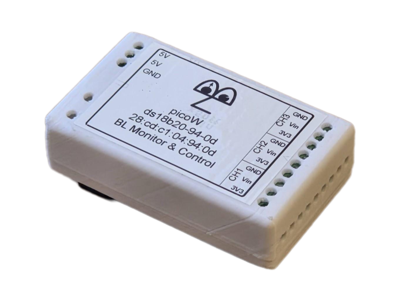
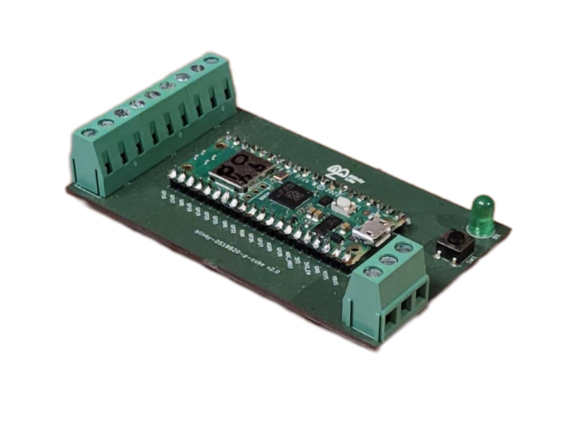

# DS18B20 Cube

**Three-channel, wireless digital temperature measurement for rugged environments using hermetically sealed DS18B20 sensors.**

| Enclosure | PCB |
|-----------|-----|
||

## Overview

The DS18B20 Cube is a compact, wireless instrumentation module in the Blinky-Lite Instrumentation Platform. It is designed to read three DS18B20 digital temperature sensors near the equipment or environment being monitored, then communicate temperatures and alarms to a central Blinky-Lite control system.

DS18B20 sensors are available in hermetically sealed packages, making them well suited to rugged deployments. Each channel provides precise temperature measurement from −55 °C to +125 °C with 0.0625 °C resolution.

Built around the Raspberry Pi Pico W / RP2040, the module uses 2.4 GHz Wi-Fi and MQTT publish/subscribe communication. This event-driven approach supports distributed deployments without wired data connections and enables Blinky-Lite to use device information for recording, notifications, visualisation, and machine-protection workflows.

### Key features

- Three-channel temperature measurement: Read three independent DS18B20 temperature sensors.
- Rugged sensor options: Supports DS18B20 detectors supplied in hermetically sealed packages for demanding environments.
- Wide temperature range: Measure from −55 °C to +125 °C.
- Fine temperature resolution: 0.0625 °C per channel.
- PLC-style field wiring: 5 mm screw terminals are used for all sensor and power connections.
- Wireless connectivity: 2.4 GHz Wi-Fi for remote or distributed installations.
- Event-driven integration: MQTT publish/subscribe communication with Blinky-Lite for prompt temperature and alarm reporting.
- Open-source firmware: Microcontroller code can be adapted for site-specific instrumentation and integration requirements.

### Technical summary

| Specification | Details |
|---------------|---------|
| Primary function | Digital temperature measurement |
| Sensor / interface | DS18B20 digital temperature sensors |
| Channels | Three independent DS18B20 channels |
| Measurement / operating range | −55 °C to +125 °C |
| Resolution | 0.0625 °C |
| Sensor packaging | Compatible with hermetically sealed DS18B20 packages for rugged deployments |
| Inputs / outputs | 5 mm screw terminals for DS18B20 sensor wiring |
| Power input | 5 V DC via 5 mm screw terminals |
| Wireless | 2.4 GHz Wi-Fi |
| Communication | MQTT publish/subscribe protocol |
| Controller | Raspberry Pi Pico W / RP2040 |
| PCB dimensions | 50 mm × 87 mm |
| Enclosure and mounting | 55 mm × 93 mm × 26 mm; DIN Mod3-compatible enclosure with removable DIN-rail mount |
| Platform | Blinky-Lite Instrumentation Platform |

### Typical applications

- Rugged environmental temperature monitoring
- Equipment and enclosure temperature monitoring
- Laboratory, industrial, and facility temperature measurement
- Distributed temperature sensing requiring central visibility
- Temperature alarms and machine-protection workflows

## Getting started

### Hardware

1. Install the DS18B20 Cube close to the sensors or equipment being monitored.
2. Connect each DS18B20 sensor to its assigned 5 mm screw terminals according to the product wiring documentation.
3. Use hermetically sealed sensor packages and appropriate cable routing where environmental protection is required.
4. Connect the regulated 5 V DC supply through the dedicated 5 mm screw terminals.
5. Mount the enclosure on a DIN rail when required, or remove the DIN-rail mount for an alternative installation.

### Firmware build target

The firmware targets the Raspberry Pi Pico W / RP2040 using the Arduino-Pico board support.
- Board: Pico W / RP2040-compatible target
- Flash layout: Sketch 1920 KB, filesystem 128 KB
- FQBN flash option: flash=2097152_131072

### Open-source software and licensing

The firmware is released under the MIT License, giving users broad permission to study, modify, and adapt the code for their own applications. The open hardware design can likewise be customised to suit site-specific requirements. The firmware uses the open-source Arduino-BlinkyPicoW library, which is also available under the MIT License.

### Configuration

1. Build and upload the firmware using the project’s source and configuration files.
2. Use the onboard web interface to set or update Wi-Fi credentials.
3. Configure the MQTT connection and create the corresponding device integration in Blinky-Lite.
4. Set temperature scaling, alarm thresholds, and any required operating limits for each channel.
5. Verify that normal temperatures and alarm events appear as expected in Blinky-Lite.

### Integration model

The DS18B20 Cube uses MQTT to publish temperature measurements and alarm events. This event-driven model avoids conventional polling and enables prompt control-system responses to changing thermal conditions.

In a typical deployment, the device connects by Wi-Fi to the network and communicates through an MQTT broker. Blinky-Lite represents it as an integrated instrumentation node and can use its information for recording, display, notification, alarms, and machine-protection logic.

### Measurement, safety, and installation considerations

- Confirm that connected sensors, wiring, and environmental conditions are within the product’s specified limits.
- Use suitable hermetically sealed DS18B20 packages and cable protection for rugged or wet environments.
- Verify sensor wiring and channel identification before operation.
- Validate normal operation and alarm behaviour against a known reference source before relying on the device for operational or protection decisions.
- Review field wiring, connector, cable routing, grounding, shielding, enclosure, and environmental requirements before installation.

